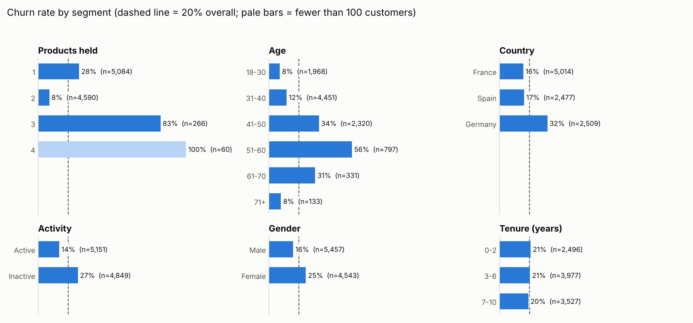

# Power BI Projects

Dashboards built to answer one product question each, and to end in a decision, not just a chart.

| Project | The question | Headline |
|---|---|---|
| [**Bank customer churn**](./customer-churn-analysis) | Which bank customers are most likely to leave, and what should a product team test first? | Inactivity and holding 3+ products are the clearest warning signs. Tenure and credit score barely matter. The v2 also corrects three of my own v1 conclusions |

## How I approach a dashboard

1. **Start from the decision.** What will someone do differently after looking at this?
2. **Show the rate next to the sample size.** A 100% churn rate across 60 customers isn't the same story as 56% across 800.
3. **End with experiments, not just recommendations.** Each finding becomes a hypothesis with a first step and a success metric.

**Tools:** Power BI Desktop · Power Query · DAX · Excel · Python (for checking the numbers)

---

More of my work: [github.com/Sriram200009](https://github.com/Sriram200009) · [LinkedIn](https://www.linkedin.com/in/sriram-aramuthan)
