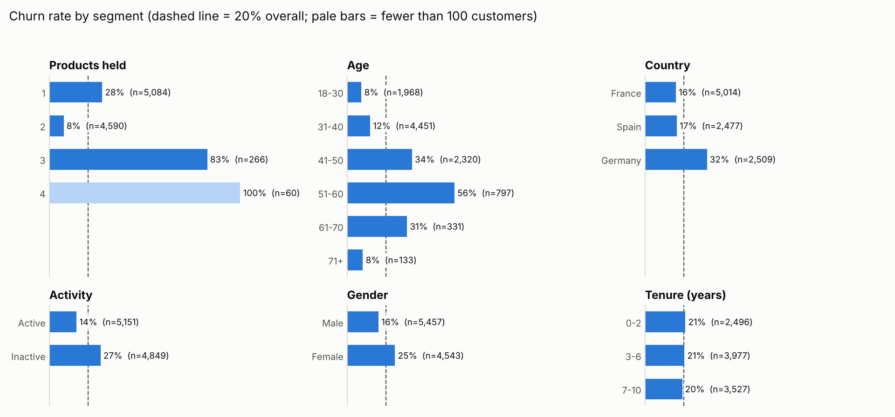
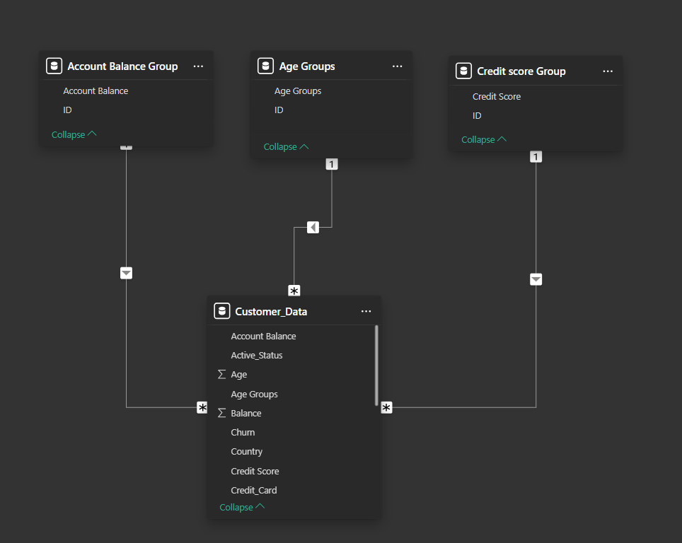

# Bank Customer Churn: Who Leaves, and What to Test First

**The question:** one in five customers at a retail bank has left. Which customers are most at risk, and what should a product team test first to keep them?

**Data:** 10,000 customers from a public bank-churn dataset on Kaggle ([`data/customer_churn_data.csv`](./data/customer_churn_data.csv)): credit score, country, gender, age, tenure, balance, number of products, card ownership, activity status, and whether they churned.

**Built with:** Power BI Desktop, Power Query, DAX, plus a short Python script that re-checks every number straight from the raw data.



## What the data says

Overall churn is **20.4%** (2,037 of 10,000 customers).

| # | Signal | Churn rate | How strong |
|---|---|---|---|
| 1 | Customers holding **3 or 4 products** | **83%** of 266, **100%** of 60 | Strongest signal, but a small group: 3% of customers |
| 2 | Customers aged **51–60** | **56%** of 797 (vs 8% for 18–30) | Strong: churn climbs steadily from 41 onwards |
| 3 | Customers in **Germany** | **32%** vs 16–17% in France and Spain | Strong: twice the rate, on a large base |
| 4 | **Inactive** customers | **27%** vs 14% for active ones | Strong; inactive customers in Germany reach **41%** |
| 5 | **Women** | **25%** vs 16% for men | Moderate |
| — | Tenure, credit score, card ownership | 20–23% across every band | **No real signal** |

## What I'd test, as the product manager

| Signal | Hypothesis | First step | Success metric |
|---|---|---|---|
| 3+ products churn at 83–100% | Customers are being cross-sold products they don't want, and leave over the fees or the hassle | Pull the cross-sell history; interview 10 churned multi-product customers *before* building anything | Churn among customers with 3+ products |
| Inactivity doubles churn | Dormancy is an early warning that can be caught in time | Trigger a re-engagement nudge after 60 days of inactivity; A/B test it against no nudge | Reactivation rate; 90-day churn, nudged vs control |
| Ages 41–60 churn the most | This group's needs (retirement, children's education) aren't served, so they move to a bank that offers them | A pre-retirement proposition, tested with a small pilot group first | 90-day churn for ages 41–60 |
| Germany churns at twice the rate | Something specific to that market: pricing, a competitor, or service | Compare fees, ratings and complaints in Germany against France and Spain | The gap between Germany's churn rate and the other two countries' |

**Limits:** this is a snapshot with no dates, so it shows which groups churn, not why or in what order. For example, product count may have changed right before customers left. Every row above is a hypothesis to test, not a conclusion.

## What I corrected in v2

I re-ran every finding from the raw data ([`analysis/churn_drivers.py`](./analysis/churn_drivers.py)). Three conclusions in my first version didn't hold up:

| v1 said | The data says | What went wrong |
|---|---|---|
| Men are more likely to churn | **Women** churn more (25% vs 16%) | I read men's *share of all churners* as their churn rate |
| Product 2 customers with a 1k–10k balance churn at 100% | That segment has **one customer** | I didn't check sample size before drawing a conclusion |
| Reward long-tenure customers to cut churn | Churn is flat across tenure (20–21%) | The recommendation wasn't backed by any finding |

The lesson I took away: **always read a rate next to its sample size.** The v1 dashboard screenshot ([`images/dashboard_v1.png`](./images/dashboard_v1.png)) was taken with a "churned only" filter on, which is why every rate on it reads 100%.

## How it's built

1. **Power Query:** promoted headers, dropped the estimated-salary column, recoded the 0/1 flags into labels (`churn` 1 → "Yes", 0 → "No"), grouped age, credit score and balance into bands, and added sort-order tables so the bands sort in logical order instead of alphabetically.
2. **Data model:** customer table linked to the band lookup tables (many-to-one).
   
3. **DAX measures:**
   ```DAX
   Customers         = COUNT ( Customer_Data[Customer_ID] )
   Customers Churned = CALCULATE ( [Customers], Customer_Data[Churn] = "Yes" )
   Churn Rate        = DIVIDE ( [Customers Churned], [Customers] )
   ```
4. **Report:** churn rate by segment, with slicers for country, gender and product.

## Files

```
customer-churn-analysis/
├── bank_customer_churn.pbix      Power BI report
├── data/customer_churn_data.csv  raw data (10,000 rows)
├── analysis/churn_drivers.py     re-checks every number and draws churn_drivers.png
├── analysis/churn_by_segment.csv churn rate and sample size for every segment
└── images/                       charts, v1 dashboard, data model
```

## Run it

- **Dashboard:** open `bank_customer_churn.pbix` in Power BI Desktop.
- **Re-check:** `pip install matplotlib`, then `python analysis/churn_drivers.py`.

## Credit

The approach was first inspired by [this churn-analysis tutorial](https://www.youtube.com/watch?v=HHu0FLM6Fp0). The v2 re-analysis, the corrections and the experiment plan are my own.
